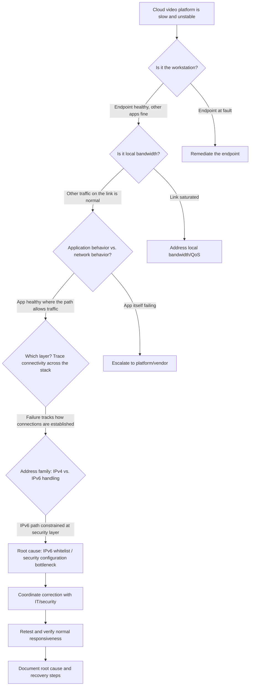

# IPv6 Whitelist Bottleneck — Root Cause Analysis Case Study

*This is a sanitized write-up of a real operational incident. Environment-specific identifiers, addresses, and internal details have been removed; the troubleshooting method and reasoning are preserved as they happened.*

**Author:** Armando Gomez — Network & Systems Technician, real-time crime center (24/7 public-safety operations: 911/CAD and multi-agency feeds)

---

## Summary

A cloud-connected video platform used in daily operations became severely slow and unstable. Structured, layer-by-layer troubleshooting ruled out the local workstation and local bandwidth as the primary cause and isolated the problem to an IPv6-related whitelist / security configuration bottleneck. The fix was coordinated with IT/security, and normal responsiveness was verified after remediation.

## Environment

- **Setting:** A real-time crime center running 24/7. Uptime and responsiveness are operationally critical because the same network carries 911/CAD workloads and multiple agency feeds.
- **Affected system:** A cloud video platform (SaaS) reached over the public internet from an operator workstation on the enterprise network.
- **Path:** Operator workstation → enterprise LAN/edge (firewall, security controls) → internet → cloud platform.
- **Constraints:** Changes to security controls are owned by the IT/security team; the investigation had to produce enough evidence to justify and target a configuration change precisely.

## Symptom

The cloud video platform was severely slow to load and unstable in use — degraded interactivity and unreliable streaming — while other everyday network activity on the same workstation appeared normal. The degradation was persistent rather than a brief blip, which made it a candidate for a configuration or path problem rather than transient congestion.

## Investigation

The investigation moved deliberately up the stack, ruling out the cheapest and most local explanations first before escalating to shared infrastructure.

1. **Workstation performance — ruled out.** The endpoint itself was checked first: resource usage and general responsiveness did not explain the problem. Other applications behaved normally on the same machine, so the workstation was eliminated as the cause.
2. **Local bandwidth — ruled out as the primary issue.** Available local bandwidth was considered next. General network activity and other traffic on the same link performed as expected, so a simple saturation/bandwidth-starvation explanation did not hold up as the primary driver.
3. **Application behavior vs. network behavior — compared.** With the endpoint and raw bandwidth cleared, the next question was whether the platform's own application layer was at fault or whether the network path was misbehaving. The pattern pointed at the path: the application was healthy where the network let traffic through, and the failure tracked how connections were being established rather than what the application was doing.
4. **Connectivity evidence — reviewed across layers.** Connectivity was examined systematically instead of assumed. Reviewing how the client reached the service — name resolution, which address family connections used, and where connections stalled versus succeeded — surfaced a consistent asymmetry tied to address family rather than to the destination service being down.
5. **Isolation to the responsible layer.** Tracing the problem across the layers pointed away from the endpoint and away from general bandwidth, and toward how IPv6 traffic to the platform was being handled by the security configuration on the path.

## Root Cause

An **IPv6-related whitelist / security configuration bottleneck**. The security allow-listing that governed traffic to the cloud platform did not treat IPv6 the same way it treated IPv4. As a result, connections that attempted the IPv6 path were constrained or blocked at the security layer, producing the slow, unstable behavior the operators experienced — even though the endpoint was healthy and local bandwidth was adequate.

## Remediation

The required configuration correction was **coordinated with the IT/security team**, who own the relevant controls. The evidence gathered during the investigation — showing the problem was tied to how IPv6 traffic was allow-listed rather than to the workstation, local bandwidth, or the application itself — made it possible to target the change precisely instead of guessing. The correction aligned the security/whitelist handling so traffic to the platform was no longer bottlenecked at that layer.

## Verification

After the change, the platform was **retested and verified**: responsiveness returned to normal and the instability did not recur. Verifying after remediation — rather than assuming the change worked — confirmed that the corrected configuration, and not an unrelated factor, resolved the incident. The root cause and recovery steps were then documented.

## Lessons Learned

- **Rule out the cheap, local explanations first — but keep going.** Clearing the workstation and local bandwidth early prevented wasted effort, but the real cause lived further up the path.
- **IPv4 and IPv6 are not automatically treated alike.** Security controls and whitelists can diverge by address family; dual-stack clients can silently take a path that is constrained on one family and fine on the other.
- **Distinguish application behavior from network behavior.** Separating "is the app broken" from "is the path broken" narrowed the search quickly.
- **Escalate with evidence, not a hunch.** Bringing a targeted, evidence-backed finding to IT/security made the configuration correction fast and precise.
- **Verify after remediation and document.** Confirming normal behavior post-change, then recording root cause and recovery steps, closes the loop and shortens the next similar incident.

---

## Troubleshooting Decision Tree

---

## Repository Contents

- [`docs/methodology.md`](docs/methodology.md) — a reusable structured root-cause-analysis methodology.
- [`docs/ipv6-connectivity-checklist.md`](docs/ipv6-connectivity-checklist.md) — a practical checklist for diagnosing IPv6/connectivity issues on enterprise and SaaS systems.
- [`LICENSE`](LICENSE) — MIT.
